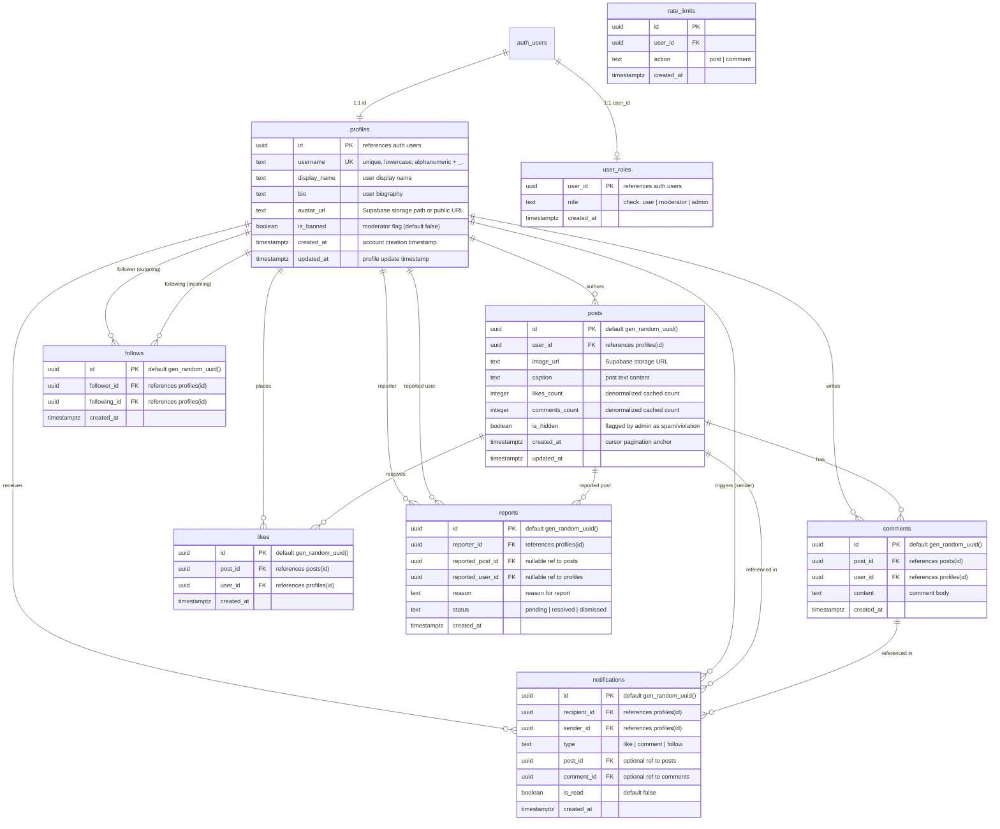

# AzGram Database Architecture & ER Diagram

## 1. Overview
AzGram is a production-oriented social network with a budget of 0 AZN using **Supabase Free Tier (PostgreSQL 15+)**.
All persistent data is stored in PostgreSQL with strict Row Level Security (RLS), atomic transactional triggers, foreign key constraints, and anti-spam rate limiting.

## 2. Mermaid Entity-Relationship (ER) Diagram

## 3. Database Constraints & Guarantees
1. **Self-Follow Prevention:**
   `CHECK (follower_id <> following_id)` ensures users can never follow themselves.
2. **Duplicate Follow Prevention:**
   `UNIQUE (follower_id, following_id)` prevents repeated follow spam.
3. **Duplicate Like Prevention:**
   `UNIQUE (post_id, user_id)` guarantees idempotent likes.
4. **Cascade Deletions:**
   Deleting a profile cascades to user's posts, likes, comments, and follows.
   Deleting a post cascades to its likes, comments, and post-linked reports.
5. **Denormalized Counters Consistency:**
   Triggers maintain `likes_count` and `comments_count` directly in PostgreSQL, eliminating `COUNT(*)` table scans on large feeds.
